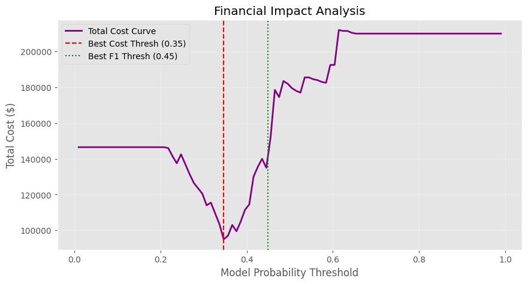
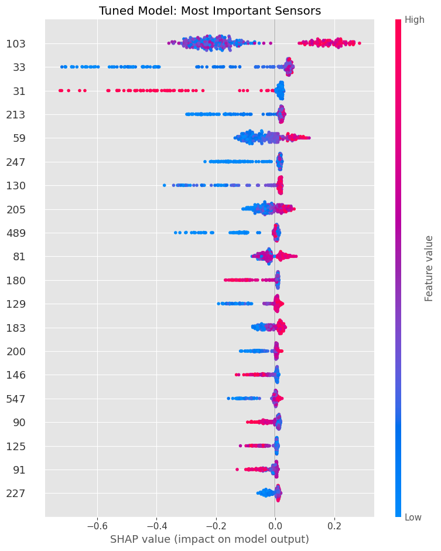
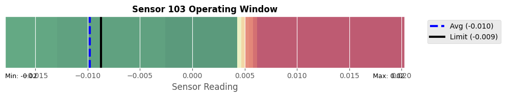

# Semiconductor Yield Optimization & Root Cause Analysis
### Determining Sensor Limits for Manufacturing using XGBoost and SHAP

## Summary
This project uses the UCI SECOM dataset to study defect detection when failures are rare and missed defects cost more than false alarms. The pipeline combines preprocessing, cost-sensitive XGBoost and model interpretation to:
1.  **Predict Failures:** Identify **48% of yield excursions** in the reported evaluation. This is model recall, not a measured improvement over an existing plant control system.
2.  **Optimize Business Value:** Tuned the model based on financial impact (Cost of Scrap vs. Cost of Inspection) rather than just raw accuracy.
3.  **Define Control Limits:** Used interpretability techniques to propose actionable changes similar to SPC.

The results below describe the notebook analysis. The app training module uses SMOTE before fitting XGBoost, so its saved model should be evaluated separately from the notebook run. A Streamlit dashboard adapts the notebook workflow and simulates live inference on process data. The dashboard can be viewed here: https://secom-dash.streamlit.app/ 

---

## The Business Problem
* **The Data:** UCI SECOM Dataset (Semiconductor Manufacturing). 590 sensors, ~1500 batches.
* **The Challenge:**
    * **Extreme Class Imbalance:** Failures are rare (~6%), making standard models biased toward "Pass."
    * **High Dimensionality & Noise:** Hundreds of redundant sensors.
    * **Cost Asymmetry (simulated):** A missed failure (False Negative) costs **$10,000**, while a false alarm (False Positive) costs only **$500**.

---

## Code Structure

### 1: Preprocessing/Cleaning
The preprocessing pipeline handles missing values, inactive sensors and correlated features:
* **Variance Thresholding:** Removed 100+ "dead" sensors (zero variance).
* **Multicollinearity Filter:** Dropped redundant features ($r > 0.95$) to reduce noise.
* **KNN Imputation:** Used K-Nearest Neighbors to fill missing data using similarities across sensor measurements.

### 2: Cost-Sensitive Modeling
I trained an **XGBoost Classifier** specifically tuned for imbalance:
* **Class Weights:** Applied `scale_pos_weight` to heavily penalize missed failures.
* **Hyperparameter Tuning:** Used `RandomizedSearchCV` to optimize tree depth and learning rate.
* **Performance:**
    * **ROC-AUC:** Improved from 0.50 (Baseline) to **0.733** (Tuned).
    * **Recall:** The final model captures **48%** of all defects.

### 3: Financial Optimization
The decision threshold changes the balance between missed defects and false alarms. I compared the default 0.50 threshold with thresholds chosen for F1 and for the simulated scrap/inspection costs:

* **F1-Score Threshold:** 0.45.
* **Minimum Cost Threshold:** **0.35**.
* **Decision:** The reported analysis selects **0.35**. It accepts more false alarms to reduce missed defects under the stated cost assumptions.

### 4. Engineering Insights (Root Cause Analysis)
Using **SHAP (SHapley Additive exPlanations)**, we identified **Sensor 103** as the #1 predictor of failure.

### 5. Virtual Metrology
I used **Partial Dependence Plots (PDP)** to examine the model response to Sensor 103 and propose a candidate operating window based on the SHAP findings.

* **Observation:** The fitted model associates Sensor 103 values below **-0.012** with lower failure risk.
* **Risk Spike:** The PDP analysis reports a doubling in predicted failure probability as the value crosses **-0.009**.
* **Recommendation:** Evaluate **-0.012** as a candidate Upper Control Limit (UCL) for Sensor 103. The model response alone does not establish that changing the sensor value will prevent a defect.

---

## Results and Evaluations
The reported model reaches 0.733 ROC-AUC and 48% defect recall. SHAP and PDP help identify a sensor setting to investigate, while the cost analysis compares inspection and scrap tradeoffs. The original **$50,000 - $100,000 per year** estimate is a projection based on assumed scrap reduction, not savings measured in a manufacturing deployment. The proposed control limit still needs process and intervention validation. 

---
## Future Steps
- Consider extension of this dataset using synthetic data generation for training new models
- Use a simpler tree based model to create interpretable procedural documents in a flowchart/tree for operators
- Utilize a constrained VAE to develop a more balanced dataset for training

